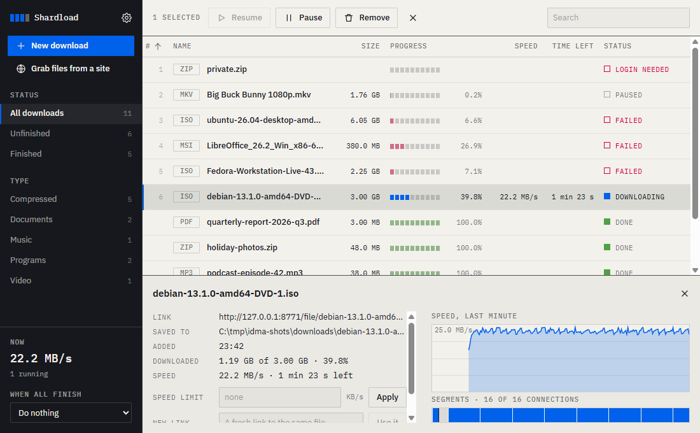
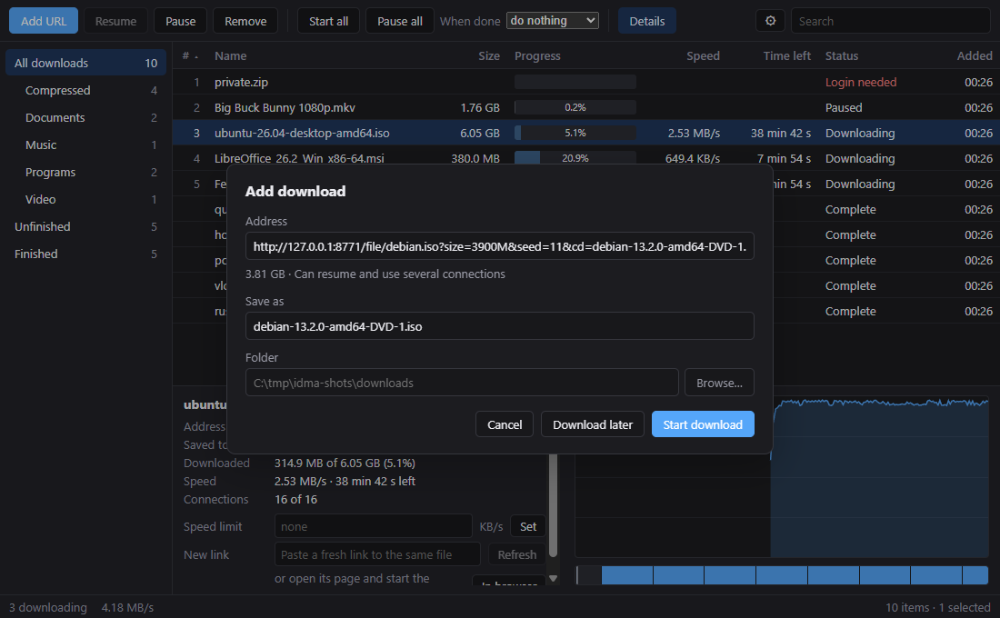
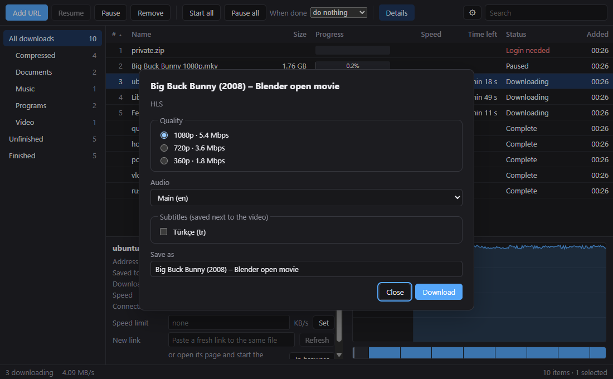
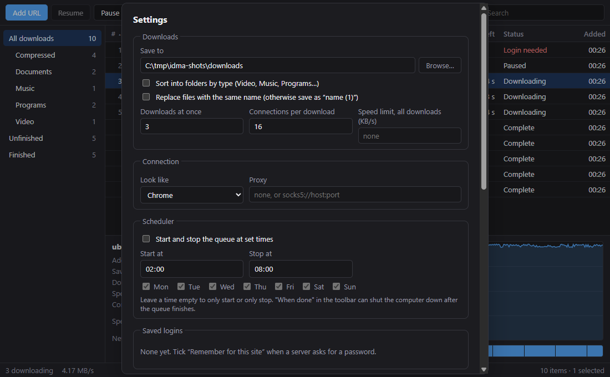
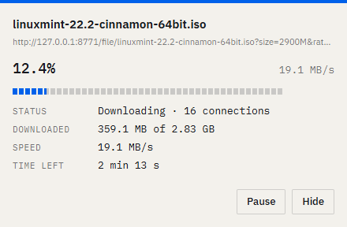
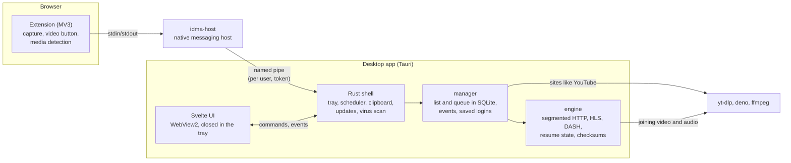

# idm-alternative

An open-source download manager for Windows that aims to match Internet Download Manager
feature for feature, built by combining the best ideas from existing open-source projects.

> **Status:** usable day to day on Windows. The engine, the desktop app, browser integration
> and video downloads work and are installed from a per-user installer; polishing
> is nearly done.



## What it does

- **Fast, resilient downloads.** Up to 16 connections per file with time-based work stealing:
  a connection that crawls has its range taken over, so the last percent does not drag. One
  preallocated file (no joining parts at the end), resume after a crash or `kill -9`, checksum
  verification, HTTP/2, browser TLS fingerprints, proxies, global and per-download speed limits.
- **Browser integration** for Chrome, Edge and Firefox: downloads are taken over with the
  browser's cookies, referrer and user agent, over native messaging (no open localhost port).
  An expired link is refreshed by starting the download again in the browser.
- **Video.** A download button over videos in the page; HLS and DASH downloaded by the engine
  itself (parallel segments, AES-128) with quality, audio track and subtitle choice; sites such
  as YouTube and X through yt-dlp, which the app installs and keeps up to date.
- **Like IDM:** categories, a queue with automatic retries, a scheduler, "when done" sleep or
  shut down, batch downloads (`photo[001-100].jpg`), clipboard monitoring, saved logins per
  site, a virus scan when a download finishes, a small progress window per download, and a
  tray icon. Interface in English and Turkish.

| | |
|---|---|
|  |  |
|  |  |

## How it fits together



The engine knows one download at a time and nothing about lists; the manager owns the list,
the queue and the events; the app is a thin shell that the browser host reaches through a
named pipe only this Windows user can open. More in [docs/ARCHITECTURE.md](docs/ARCHITECTURE.md)
and the decisions in [docs/decisions](docs/decisions).

## Stack

| Layer | Tech |
|---|---|
| Engine, manager, CLI, native host, test server | Rust (tokio, wreq) |
| Desktop app | Tauri 2 + Svelte 5 (SvelteKit, static) |
| Storage | SQLite (sqlx), request headers encrypted with DPAPI |
| Browser extension | TypeScript, Manifest V3 (+ Firefox build) |
| Media | the engine for HLS/DASH; yt-dlp + deno for sites; ffmpeg to join tracks |

## Repository layout

```
crates/
  engine/       download engine (library): HTTP segments, HLS, DASH, subtitles
  manager/      download list, queue, events, saved logins, batch patterns
  media/        HLS and DASH playlist parsing
  bridge/       messages and the named pipe between browser host and app
  native-host/  `idma-host`, the native messaging host the browser starts
  cli/          `dm` command-line front end
  testserver/   HTTP server reproducing hostile download scenarios (and HLS/DASH)
  bench/        benchmark runner
app/            Tauri 2 + SvelteKit desktop app, installer (`npm run bundle`)
extension/      browser extension (MV3; Chromium and Firefox builds)
docs/           architecture, design decisions, screenshots
```

## Building

Requires Rust 1.99 (pinned in `rust-toolchain.toml`) and, on Windows, the MSVC build tools. The engine uses
[wreq](https://github.com/0x676e67/wreq) (BoringSSL, for browser TLS fingerprints), whose build also needs
CMake, NASM and LLVM (libclang) on `PATH`, e.g. `winget install Kitware.CMake NASM.NASM LLVM.LLVM`.
Keep the checkout path short: MSBuild fails on BoringSSL objects past 260 characters.

```bash
cargo build
cargo test
```

The desktop app (`app/`) also needs Node 24. It embeds the built web UI, so plain `cargo`
commands leave it out:

```bash
cd app
npm ci
npm run tauri dev     # development, with hot reload
npm run bundle        # installer in target/release/bundle/nsis
```

`npm run bundle` builds the browser host (`idma-host.exe`) first and ships it next to the app.
When the update signing key is on the machine (`%USERPROFILE%\.tauri\idma.key`, its password
DPAPI-encrypted in `idma.key.password`), it also signs the installer and writes `latest.json`;
uploading both to a GitHub release `v<version>` is what the app's daily update check looks for.
The check needs the releases to be public.
The installer is per user (no administrator rights) and silent with `/S`. Uninstalling removes
the app's keys from the browsers and the "start with Windows" entry, and keeps the download
list in `%APPDATA%\io.github.monurpalan.idma`.

## Size and memory

Measured on the development machine (release build, Windows 11):

| | |
|---|---|
| Installer | 6.1 MiB |
| Installed | 24.2 MB (app 23.4 MB, browser host 0.7 MB) |
| Idle memory, app process | 32 MB working set (8 MB private) |
| Idle memory, WebView2 (6 processes) | 367 MB working set (160 MB private) |
| Idle in the tray (window closed) | 5 MB private, no WebView2 processes |
| 500 downloads in the list, 20 running (~10 MB/s) | UI 9% of a core, engine 18–22%; scrolling at 60 fps |

Most of the memory is the WebView2 runtime that every Tauri app shares with Edge; IDM's
native window needs far less. In the tray the app closes its window and the WebView with it,
so that price is only paid while the window is open.

## Benchmarks

`dm` (the engine's command-line front end) against IDM 6.43, Gopeed 1.9.3, AB Download Manager
1.11.1, aria2 and curl, measured with [`idma-bench`](bench/README.md) on 2026-10-18. Every file was
verified byte for byte (local) or by size and SHA-256 (internet). Medians of 3 runs, clients in a
new shuffled order each round. Free Download Manager is not in the table: it has no command line
or local API to start a download from.

**Seconds, lower is better** ([local](bench/results/2026-10-18_011811.md),
[internet](bench/results/2026-10-18_011946.md)). `dm x8` uses IDM's and AB DM's default of 8
connections; the others use their defaults (dm, aria2 and Gopeed 16).

| Scenario | dm | dm x8 | IDM | aria2 | Gopeed | AB DM¹ | curl |
|---|---:|---:|---:|---:|---:|---:|---:|
| Internet, 100 MiB² | **2.58** | 2.68 | 4.31 | 2.96 | 12.78 | 2.77 | 4.60 |
| Clean, 1 GiB, local³ | 3.54 | **2.80** | 5.99 | 6.88 | 16.12 | 8.38 | 3.87 |
| 4 MiB/s per connection, 256 MiB | **4.05** | 8.04 | 9.75 | 4.20 | 4.17 | 8.04 | 64.03 |
| One connection crawls at 64 KiB/s | **2.40** | 4.43 | 8.61 | 10.28 | 10.10 | 31.58 | 32.03 |
| Server allows 4 connections | 8.35 | **8.14** | 9.04 | 8.27 | 13.18 | 9.23 | 32.03 |
| Connections reset every 4 MiB | **1.50** | 3.09 | 4.82 | 3.14 | 7.51 | 9.87 | fails |
| No range support, 128 MiB | **8.03** | 8.03 | 8.88 | 8.12 | 8.12 | 8.12 | 8.03 |
| Says it has ranges, sends the whole file | **8.03** | 8.03 | 8.92 | 8.11 | **corrupt** | 8.12 | 8.02 |

1. AB DM's own time from its download record (added → complete). Started through its command-line
   tool, which takes about a second more; with it the times are ~1 s higher.
2. Linode Frankfurt, from Turkey, ~470 Mbit/s line. On 2026-10-16, 1000 MiB took dm 13.98 s,
   aria2 14.32 s, IDM 19.90 s, curl 28.79 s.
3. The clean local run mostly measures the disk (a DRAM-less SSD that slows down while it writes
   back): the same client swings by a factor of two between runs.

What this does and does not say:

- **Where dm stands out is a bad connection.** When one connection crawls, dm finishes in 2.4 s
  because a finished connection takes over the slow one's range; Gopeed and aria2 wait for it
  (~10 s), AB DM much longer (31.6 s). The same holds, less sharply, when connections keep dropping.
- **Gopeed 1.9.3 wrote a corrupt file** when a server advertises ranges but answers every request
  with the whole file (all three runs, even with one connection); everyone else noticed and fell
  back to one connection. It is Gopeed's known issue
  [#1458](https://github.com/GopeedLab/gopeed/issues/1458): 2.0.0-beta.3 gets it right (checked
  here, 6 of 6), but 1.9.3 is still its latest stable release.
- **Gopeed's times swing between sessions, and 2.0 is not faster.** A second session with both
  versions and dm side by side ([local](bench/results/2026-10-18_014929.md),
  [internet](bench/results/2026-10-18_015011.md)):

  | Scenario | dm | Gopeed 1.9.3 | Gopeed 2.0.0-beta.3 |
  |---|---:|---:|---:|
  | Internet, 100 MiB | **2.55** | 5.09 | 5.64 |
  | Clean, 1 GiB, local | **3.37** | 33.81 | 16.39 |
  | One connection crawls | **2.48** | 13.14 | 23.26 |
  | Connections reset every 4 MiB | **1.50** | 9.06 | 12.43 |
  | Server allows 4 connections | **8.35** | 14.17 | 17.17 |
  | Says it has ranges, sends the whole file | **8.03** | corrupt | 8.13 |

  1.9.3 took 12.78 s on the internet run in the first session and 5.09 s here, so read Gopeed's
  plain-download numbers loosely; its slowness with a bad connection repeats in both.
- **On a plain download the field is close.** aria2 and AB DM are within 15 % of dm on the internet
  run. IDM's gap is partly not network: it downloads parts into its own folder and joins them at
  the end (~1–2.7 s per GiB here), and its start and exit are in the measurement.
- **One machine, one line, one server.** Everyone ran with default settings. Browser integration,
  site compatibility and video are not measured here.

## License

[MIT](LICENSE)
