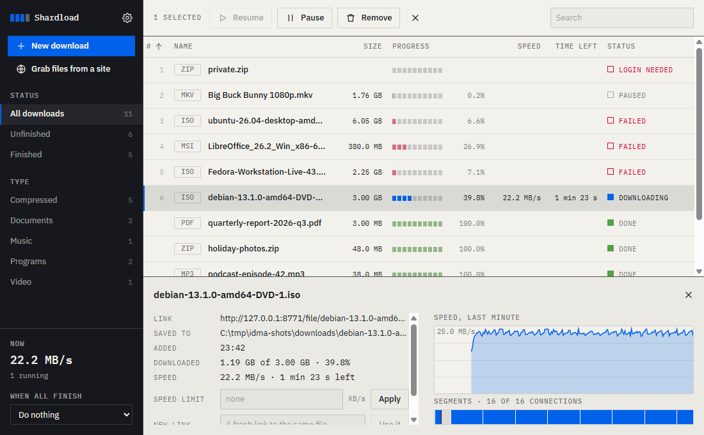
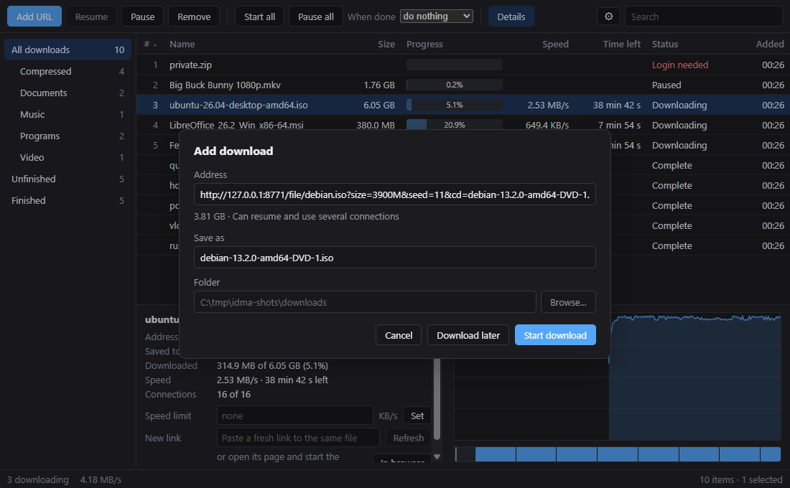
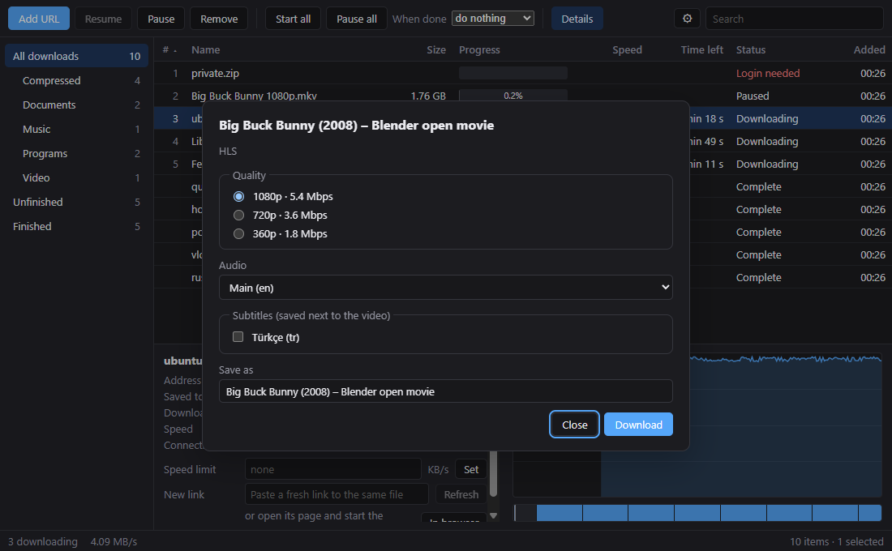
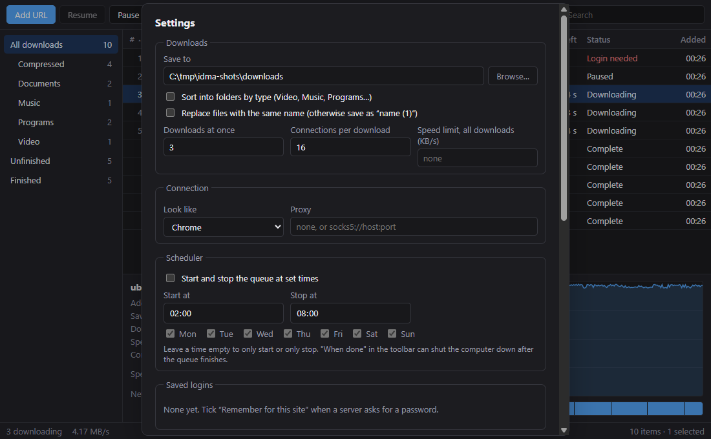
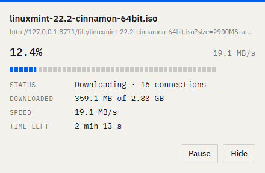
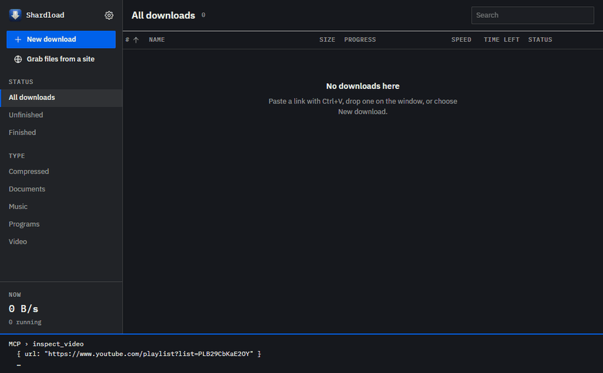
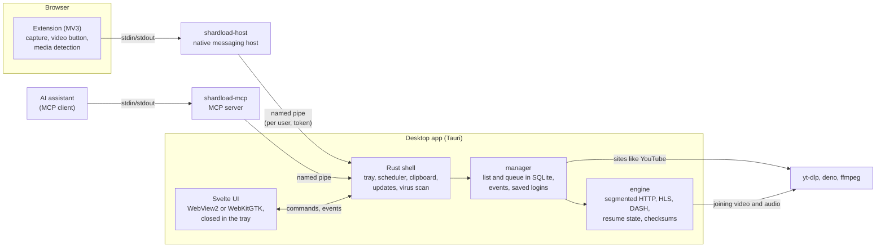

<h1 align="center">Shardload</h1>

<b>A free, open-source IDM alternative for Windows and Linux.</b> 
Splits every file into parts and downloads them at once, takes over the browser's downloads,
saves videos and torrents. No ads, no trial, no account.

<a href="https://github.com/monurpalan/Shardload-idm-alternative/releases/latest/download/shardload-setup.exe"><b>⬇ Download for Windows</b></a>
&nbsp;·&nbsp;
<a href="https://github.com/monurpalan/Shardload-idm-alternative/releases/latest">Linux (.deb, .rpm, Flatpak, AppImage)</a>
&nbsp;·&nbsp;
<a href="README.tr.md">Türkçe</a>

## Install

1. **Run `shardload-setup.exe`.** It installs for your Windows user only, without administrator
   rights, and checks for new versions once a day (it can be turned off in Settings).
   The installer is not code-signed yet, so Windows may say *"Windows protected your PC"*:
   click **More info → Run anyway**.
2. **Add the browser extension:**
   - Firefox: from [Firefox Add-ons](https://addons.mozilla.org/firefox/addon/shardload/).
   - Chrome, Edge, Brave, Vivaldi, Opera (not in their stores yet): unzip
     `shardload-extension-chromium.zip` from the
     [latest release](https://github.com/monurpalan/Shardload-idm-alternative/releases/latest), open
     `chrome://extensions`, turn on *Developer mode*, *Load unpacked* and pick the folder.
3. **That's it.** Downloads you start in the browser now open in Shardload. You can also paste a
   link with Ctrl+V or drop one on the window.

**Linux (x64):** from the same release, the `.deb` (`sudo apt install ./Shardload_*_amd64.deb`),
the `.rpm` (`sudo dnf install ./Shardload-*.x86_64.rpm`), the Flatpak
(`flatpak install --user ./Shardload_*_x86_64.flatpak`) or the AppImage (`chmod +x`, then run it).

## What it does

**Downloading**

- **Faster.** 16 connections per file (up to 64). When one connection slows down, a free one
  takes over the rest of its part, so the last percent does not drag. Resumes after a crash or
  a restart.
- **Takes over the browser's downloads** in Chrome, Edge, Brave, Vivaldi, Opera and Firefox,
  with their cookies, so downloads behind a login work too.
- **Video.** A Download button over videos in the page. YouTube, X, Instagram, TikTok, Twitch
  and many more through yt-dlp, which the app sets up and keeps up to date; HLS and DASH with a
  choice of quality, audio and subtitles. Whole playlists and channels, only a part of a video
  (say 1:05–2:30), and live broadcasts recorded until they end.
- **Torrents, FTP, FTPS and SFTP** in the same list and queue.
- **Less to download.** Just the files you need out of a ZIP; one file from several mirrors at
  once; a newer version of a file you have built from your copy when its server publishes a
  `.zsync`.
- **Site grabber.** Lists every file a site links to, to pick from.

**Checking**

- **Checks what it downloads**: against the publisher's checksum, found by itself, or, without
  one, by the file's own structure (ZIP, gzip, xz, PNG, PDF, MP4, MKV). Only a damaged part is
  downloaded again.
- **Already have it?** Says when you add something you downloaded before, or a file with the
  same checksum as one you have, and offers that one instead.
- **The skeleton first:** a ZIP's files, a video's length and size, a PDF's page count shown in
  the first seconds, so a wrong file can be stopped early.
- **Rescues** downloads the browser gave up on, keeping what it already has; offers the
  Wayback Machine for a file its server no longer has.
- **Where did this file come from?** Drop a file on the window to see its page, check it
  again, or look for a newer version.

**Running on its own**

- **Deadlines** ("done by 18:00"), **network and power rules** (metered networks, battery, a
  monthly data budget) and **rules for finished downloads** (unpack, move, run a program, call a
  webhook).
- **"Why slow?"** A running download says in a line what holds it back, when that is known for
  certain.
- **Everything you know from IDM:** categories, a queue with retries, a scheduler, sleep or shut
  down when done, batch downloads (`photo[001-100].jpg`), clipboard monitoring, saved logins, a
  virus scan, a progress window per download, a tray icon and speed limits.
- **For AI assistants** an [MCP](https://modelcontextprotocol.io) server, and `shard` for the
  command line (built from source for now, see [docs/DEVELOPMENT.md](docs/DEVELOPMENT.md)).
- English and Turkish.

| | |
|---|---|
|  |  |
|  |  |

## How it compares

**Speed.** Seconds, lower is better; medians of several runs on one machine and one line
([how it was measured](#speed-tests)):

| | Shardload x16 | IDM 6.43 | aria2 | AB Download Manager | Gopeed |
|---|---:|---:|---:|---:|---:|
| Internet, 1000 MiB | **12.94** | 20.04 | 15.46 | 23.91 | 48.25 |
| One connection slows to 64 KiB/s | **2.39** | 8.72 | 10.25 | 32.53 | 10.64 |
| Connections drop every 4 MiB | **1.50** | 4.86 | 1.57 | 10.82 | 7.50 |

**Features**, as each project describes itself on its own site or README (checked 2026-10-18;
"?" where it does not say):

| | Shardload | IDM | Free Download Manager | Gopeed | AB Download Manager |
|---|---|---|---|---|---|
| Price | Free | 30-day trial, then paid | Free | Free | Free |
| Source code | Open (MIT) | Closed | Open¹ | Open (GPL-3.0) | Open (Apache-2.0) |
| Windows · Linux | ✓ · ✓ | ✓ · – | ✓ · ✓ | ✓ · ✓ | ✓ · ✓ |
| macOS · Android | – · – | – · – | ✓ · ✓ | ✓ · ✓ | ✓ · ✓ |
| Browser extension | ✓ | ✓ | ✓ | ✓ | ✓ |
| Torrents and magnet links | ✓ | – | ✓ | ✓ | ? |
| YouTube and other video sites | Built in | Video the page plays | Through add-ons | Through extensions | ? |
| Queue and scheduler | ✓ | ✓ | ? | ? | ✓ |

1. Its site calls it open source but names no license.

Shardload also picks files out of a ZIP without downloading the archive, downloads one file
from several mirrors at once, lists the files a whole site links to, and can be driven by an AI
assistant over MCP; see [every feature](#every-feature) below.

## In detail

For those who want to know exactly what it does, how it was measured and how it is built.

### Every feature

**Downloading**

- **Segmented HTTP.** 16 connections per file by default (up to 64), with time-based work
  stealing: a connection that crawls has its range taken over. One preallocated file (no
  joining at the end), resume after a crash or `kill -9`, HTTP/2, browser TLS fingerprints,
  proxies, speed limits, time left shown as a range. Headers can be added by hand, or a whole
  request pasted as a curl, wget or PowerShell command (a browser's "Copy as cURL").
- **Browser integration** over native messaging (no open localhost port), with the browser's
  cookies, referrer and user agent. An expired link is refreshed by starting the download again
  in the browser. The extension's popup lists downloads the browser left interrupted;
  "Continue in Shardload" keeps the browser's partial file (`.crdownload`, `.part`) when the
  server still sends the same file.
- **Video.** HLS and DASH downloaded by the engine itself (parallel segments, AES-128); other
  sites through yt-dlp, installed and updated by the app only once its release's signature
  checks out with yt-dlp's key. ffmpeg (to join video and audio) is the one on `PATH`, or an
  official build set up on first need and checked against its SHA-256. Playlists and channels
  are listed to pick from; clips download only the segments the range falls in; live HLS is
  recorded until it ends, a time limit or Pause, and YouTube or Twitch live through yt-dlp.
  Tried on 2026-10-18 with public pages of 16 sites (YouTube, X, TikTok, Instagram, Facebook,
  Twitch and others); Vimeo and Reddit asked for a login.
- **Torrents** (librqbit): magnet links and `.torrent` files with a choice of files; nothing
  seeds afterwards. Opening them from Windows is a setting, off by default.
- **FTP, FTPS and SFTP:** `ftp://`, `ftps://` (implicit TLS), `ftpes://` (`AUTH TLS`) and
  `sftp://`, up to four connections where the server supports `REST`. SFTP logs in with the
  password, the SSH agent (OpenSSH's or Pageant) or the usual key files, also with a
  passphrase; a server's host key is checked against `~/.ssh/known_hosts` and the app's own
  list, and a changed key is refused.
- **Files out of a ZIP** without downloading the rest: the list of files is read from the
  archive's end and only the chosen ones fetched (stored or deflate, ZIP64, each CRC-32
  checked). In the app, as `shard zip get URL 'docs/**/*.pdf'`, and over MCP.
- **Mirrors and Metalink.** Other addresses of a file are used at once after each is shown to
  serve the same bytes; a slow or failing one is dropped. A `.meta4` brings its mirrors, name,
  checksum and piece hashes; only a corrupt piece is downloaded again.
- **Delta updates (zsync):** when a `.zsync` sits next to a file you have an older copy of,
  every block found in your copy is reused and only the rest downloaded, then the whole is
  checked against its SHA-1.
- **Site grabber:** reads a page and, to a chosen depth, the pages below it on the same site,
  and lists the files they link to. Nothing is downloaded to find them.

**Checking**

- **Checksums:** the publisher's own is found by itself (GitHub's digest of a release asset,
  `SHA256SUMS`, `<file>.sha256` next to the file, one shown on the page).
- **Damage without a checksum** (a setting): ZIP and PNG CRCs, gzip and xz streams, a PDF's
  cross-reference table, MP4 boxes, Matroska CRC-32s. A file is called damaged only when a
  check positively fails, and only the damaged byte range is downloaded again.
- **What a file really is:** its first bytes say its type; a program named like a document, or
  a web page saved in place of the file, is warned about, and a name like `download.php` gets
  the right extension.
- **History:** adding an address you downloaded before says when. The SHA-256 of every
  finished file is kept, so a new download expected to have the same checksum offers the file
  you have: copied, or hard-linked on the same drive.
- **The skeleton first:** a few small range requests of their own read a ZIP's file list, an
  MP4's `moov` box or a PDF's page count while the download runs.
- **Where a file came from:** found in the history by its path, size and SHA-256, or by the
  mark the browser left on it (Zone.Identifier, `user.xdg.origin.url`); then checked again or
  asked for a newer version.
- **Gone from its server:** a 404 or 410 offers the Wayback Machine, only when you click: its
  copies in your browser, or the closest copy (its original bytes) added as a download.

**Running on its own**

- **Site memory:** for 30 days, how many connections a server allows, whether it supports
  ranges, which browser identity it wants. Shown and forgotten under Settings, Sites.
- **Deadlines:** set by you or taken from how long the site's links lasted. The earliest
  starts first, others make room, and one at risk (it would not finish at the current speed,
  with 10 % to spare) says so with the speed it needs.
- **Network and power:** on a metered network videos and torrents wait; on battery a speed
  limit applies; a named network can have its own proxy; a monthly data budget warns at 90 %
  and 100 % and can hold downloads until next month.
- **Disk space:** what the queue needs is counted per drive, keeping 500 MiB spare; downloads
  pause before a drive fills up.
- **When a download finishes:** rules in Settings (by category, site or name) unpack (ZIP,
  tar), move, run a program (without a shell) or POST to a webhook. The browser, the add dialog
  and MCP clients can only ask to unpack or move.
- **"Why slow?"** Only what is certain: a speed limit (with a button to lift it), a disk that
  cannot keep up, connections that keep dropping, a server that allows few connections, a
  proxy.
- **Like IDM:** categories, a queue with retries, a scheduler, sleep or shut down when done,
  batch downloads, clipboard monitoring, saved logins per site, a virus scan, a progress window
  per download, a tray icon. Rename (F2) or move a download at any stage, running ones too.
- **For AI assistants:** `shardload-mcp`, installed with the app, lets any MCP client add
  downloads (files, files out of a ZIP, torrents, video at a chosen quality, clips, playlists,
  live recordings), find a site's files, watch, wait for, pause, reorder, rename, move and
  remove them, set deadlines and limits, and tell where a file came from. It reaches the app
  through the same per-user pipe as the browser; nothing listens on a network port. Register
  it as a stdio server: `%LOCALAPPDATA%\Shardload\shardload-mcp.exe` (Linux: `shardload-mcp`;
  Flatpak: `flatpak run --command=shardload-mcp io.github.monurpalan.Shardload`).

  

### Speed tests

`shard` (Shardload's engine from the command line) against IDM 6.43, Gopeed 1.9.3, AB Download
Manager 1.11.1, aria2 1.37 and curl, measured with [`shardload-bench`](bench/README.md): the
local scenarios on 2026-11-03 (medians of 3 runs, [results](bench/results/2026-11-03_213318.md)),
the internet ones on 2026-10-18 (5 runs; [1000 MiB](bench/results/2026-10-18_133925.md),
[100 MiB](bench/results/2026-10-18_134205.md); `dm` there is shard's earlier name). Clients ran in
a new shuffled order each round, with default settings, and every file was checked byte for
byte (local) or by size and SHA-256 (internet). `shard x16` is the default; `shard x8` uses IDM's
and AB DM's default of 8 connections. Free Download Manager is not in the table: it has no
command line or local API to start a download from.

**Seconds, lower is better:**

| Scenario | shard x16 | shard x8 | IDM | aria2 x16 | Gopeed | AB DM¹ | curl |
|---|---:|---:|---:|---:|---:|---:|---:|
| Internet, 1000 MiB² | **12.94** | 16.05 | 20.04 | 15.46 | 48.25 | 23.91 | 25.24 |
| Internet, 100 MiB² | 2.59 | **2.42** | 3.89 | 3.18 | 6.16 | 2.86 | 5.35 |
| Clean, 1 GiB, local³ | 0.77 | **0.64** | 3.22 | 4.23 | 21.08 | 8.92 | 1.29 |
| 4 MiB/s per connection, 256 MiB | **4.03** | 8.04 | 10.01 | 4.20 | 4.15 | 9.00 | 64.02 |
| One connection crawls at 64 KiB/s | **2.39** | 4.43 | 8.72 | 10.25 | 10.64 | 32.53 | 32.02 |
| Server allows 4 connections | 8.34 | **8.14** | 9.13 | 8.21 | 14.14 | 11.07 | 32.02 |
| Server forbids (403) every connection beyond 4 | 8.34 | **8.14** | 9.15 | 8.20 | hangs | 11.08 | 32.02 |
| Connections reset every 4 MiB | **1.50** | 3.10 | 4.86 | 1.57 | 7.50 | 10.82 | fails |
| 300 ms before every response, 64 MiB | **1.66** | 2.66 | 4.89 | 1.70 | 2.87 | 3.61 | 16.33 |
| 16 MiB/s for all connections together, 128 MiB | 8.03 | 8.03 | 9.10 | 8.12 | 8.16 | 8.97 | **8.02** |
| No range support, 128 MiB | 8.03 | 8.03 | 9.01 | 8.12 | 8.12 | 9.07 | **8.02** |
| Says it has ranges, sends the whole file | 8.03 | **8.02** | 8.98 | 8.12 | corrupt | 9.05 | **8.02** |
| A 256 KiB file | **0.02** | **0.02** | 1.04 | 0.03 | 0.14 | 1.07 | **0.02** |

1. Local rows: measured time, including the ~1 s its command-line tool takes to start. Internet
   rows: its own record of the download (added → complete).
2. Linode Frankfurt, from Turkey, ~470 Mbit/s line. On 2026-11-03 Linode's speed-test hosts no longer
   answer, so these are the 2026-10-18 numbers.
3. Mostly measures the disk (a DRAM-less SSD that slows down while it writes back): the same
   client can swing by a factor of two between sessions.

What this does and does not say:

- **Where shard stands out is a bad connection.** When one connection crawls, shard finishes in
  2.4 s because a free connection takes over the slow one's range; aria2 and Gopeed wait for it
  (~10 s), AB DM much longer. When connections keep dropping, aria2 is about as fast.
- **On a plain download the gap is smaller.** On 100 MiB shard, aria2 and AB DM are within about a
  second of each other; on 1000 MiB shard is 16 % ahead of aria2 and 35 % ahead of IDM. Part of
  IDM's gap is not network: it downloads parts into its own folder and joins them at the end.
  IDM with 16 connections was no faster on the internet (19.91 s against 18.82 s with its 8;
  [16](bench/results/2026-10-18_132257.md), [8](bench/results/2026-10-18_132500.md)).
- **Gopeed 1.9.3 wrote a corrupt file** when a server advertises ranges but sends the whole file
  (every run); everyone else fell back to one connection. It is Gopeed's known issue
  [#1458](https://github.com/GopeedLab/gopeed/issues/1458), fixed in 2.0.0-beta.3, not yet in a
  stable release. It also hangs when a server forbids extra connections.
- **Looking for losses found one:** before 2026-10-18 shard stopped when a server forbade extra
  connections with 403 (it took that for an expired link); now it lowers its connection count.
  Where connections do not help (a per-client limit, no ranges) everyone ties; the tiny file
  shows IDM's and AB DM's start-up cost, not their engines.
- **Not measured:** a destination on a hard disk or USB stick (IDM's download-then-join should do
  better there), many small files in one go, weak hardware, browser integration and video.

### Size and memory

Measured on the development machine (release build, Windows 11; sizes of 0.1.6, memory on
2026-11-01, before FTP, SFTP and zsync were added). Memory is the sum
over the app and its WebView2 processes; *private* is what they committed (in RAM or the page
file), *in RAM* their private working set. Details, method and raw numbers:
[bench/results/2026-11-01_memory.md](bench/results/2026-11-01_memory.md).

| | |
|---|---|
| Installer | 12.7 MiB |
| Installed | 52 MB (app, torrent client included; MCP server; browser host) |
| Cold start | window in 0.08 s, list shown in 0.6 s (500 downloads: 0.8 s) |
| Window open, idle | 200 MB private (app 13 MB, WebView2 ~190 MB, half of it its GPU process); in RAM 17 MB when the window is not focused, ~130 MB when it is |
| Window open, 500 downloads in the list | the same: only the rows in view are drawn |
| Downloading 1 GiB (at 10 MiB/s, or as fast as loopback goes) | 240–275 MB private, ~110 MB in RAM |
| Closed to the tray | 18 MB private, 15 MB in RAM, 1 process (no WebView2) |

The same states for other download managers on the same machine (private, MB; median of 3 runs):

| | Shardload | IDM 6.43 | FDM 6.35 | AB DM 1.11 |
|---|---|---|---|---|
| Window open, idle | 200 | 11 | 210 | 443 |
| Downloading 1 GiB | 240–275 | 15–20 | – | 530–670 |
| Closed to the tray | 18 | 14 | 210 | 593 |

IDM's native window needs far less than any of them. Most of Shardload's memory is the WebView2
runtime that every Tauri app shares with Edge; in the tray Shardload closes its window and the
WebView with it, so that price is only paid while the window is open, and the engine itself
stays around 13 MB. FDM (Qt) and AB DM (JVM) keep theirs in the tray.

### How it works

The engine knows one download at a time and nothing about lists; the manager owns the list,
the queue and the events; the app is a thin shell that the browser host and the MCP server
reach through a named pipe only this Windows user can open. The browser host passes on only
what the extension may send (downloads for the user to confirm); listing, adding without
asking and removing are for the user's own tools. More in [docs/ARCHITECTURE.md](docs/ARCHITECTURE.md),
the decisions in [docs/decisions](docs/decisions), and how to build it in
[docs/DEVELOPMENT.md](docs/DEVELOPMENT.md).

### On Linux

Built, tested and packaged on Ubuntu 24.04 in CI, but not yet tried much on a desktop: please
report what does not work. The app talks to the browser and the MCP server over a socket only
your user can open, registers the browser host in each browser's folder (not Snap or Flatpak
browsers), sleeps and shuts down through `systemctl`, and scans with ClamAV when virus scanning
is on. Clipboard monitoring is Windows-only for now.

## Questions

**Is it related to IDM?** No. Shardload is an independent project and is not affiliated with
Internet Download Manager or Tonec Inc.; the name only says what it is an alternative to.

**Is it safe?** The code is open, every release is built from it, and the release lists the
SHA-256 of each file in `SHA256SUMS`. The installer is not code-signed yet, which is why
Windows warns before running it.

**Where are my downloads and settings?** Files go to your Downloads folder unless you choose
another one. The list and settings live in `%APPDATA%\io.github.monurpalan.shardload`
(Linux: `~/.local/share/io.github.monurpalan.shardload`).

**How do I uninstall it?** Windows Settings → Apps → *Shardload* → Uninstall. Uninstalling
also removes the browser registration; the download list stays in case you come back.

**Something does not work.** Please [open an issue](https://github.com/monurpalan/Shardload-idm-alternative/issues)
with what you did and what happened; *Settings → App → Open the log folder* has the app's log.

## Building and contributing

See [docs/DEVELOPMENT.md](docs/DEVELOPMENT.md).

## License

[MIT](LICENSE)
