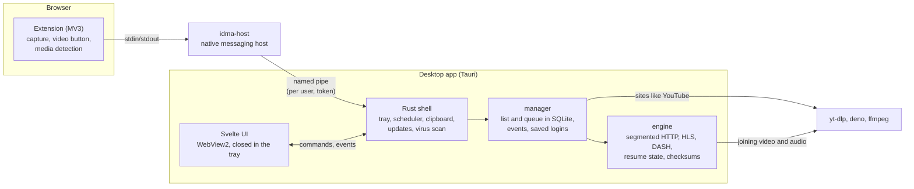

# idm-alternative

An open-source download manager for Windows that aims to match Internet Download Manager
feature for feature, built by combining the best ideas from existing open-source projects.

> **Status:** usable day to day on Windows. The engine, the desktop app, browser integration
> and video downloads work and are installed from a per-user installer; polishing
> is nearly done.


## What it does

- **Fast, resilient downloads.** Up to 16 connections per file with time-based work stealing:
  a connection that crawls has its range taken over, so the last percent does not drag. One
  preallocated file (no joining parts at the end), resume after a crash or `kill -9`, checksum
  verification, HTTP/2, browser TLS fingerprints, proxies, global and per-download speed limits.
- **Browser integration** for Chrome, Edge and Firefox: downloads are taken over with the
  browser's cookies, referrer and user agent, over native messaging (no open localhost port).
  An expired link is refreshed by starting the download again in the browser.
- **Video.** A download button over videos in the page; HLS and DASH downloaded by the engine
  itself (parallel segments, AES-128) with quality, audio track and subtitle choice; sites such
  as YouTube and X through yt-dlp, which the app installs and keeps up to date.
- **Like IDM:** categories, a queue with automatic retries, a scheduler, "when done" sleep or
  shut down, batch downloads (`photo[001-100].jpg`), clipboard monitoring, saved logins per
  site, a virus scan when a download finishes, a small progress window per download, and a
  tray icon. Interface in English and Turkish.

| | |
|---|---|
|  |  |
|  |  |

## How it fits together



The engine knows one download at a time and nothing about lists; the manager owns the list,
the queue and the events; the app is a thin shell that the browser host reaches through a
named pipe only this Windows user can open. More in [docs/ARCHITECTURE.md](docs/ARCHITECTURE.md)
and the decisions in [docs/decisions](docs/decisions).

## Stack

| Layer | Tech |
|---|---|
| Engine, manager, CLI, native host, test server | Rust (tokio, wreq) |
| Desktop app | Tauri 2 + Svelte 5 (SvelteKit, static) |
| Storage | SQLite (sqlx), request headers encrypted with DPAPI |
| Browser extension | TypeScript, Manifest V3 (+ Firefox build) |
| Media | the engine for HLS/DASH; yt-dlp + deno for sites; ffmpeg to join tracks |

## Repository layout

```
crates/
  engine/       download engine (library): HTTP segments, HLS, DASH, subtitles
  manager/      download list, queue, events, saved logins, batch patterns
  media/        HLS and DASH playlist parsing
  bridge/       messages and the named pipe between browser host and app
  native-host/  `idma-host`, the native messaging host the browser starts
  cli/          `dm` command-line front end
  testserver/   HTTP server reproducing hostile download scenarios (and HLS/DASH)
  bench/        benchmark runner
app/            Tauri 2 + SvelteKit desktop app, installer (`npm run bundle`)
extension/      browser extension (MV3; Chromium and Firefox builds)
docs/           architecture, design decisions, screenshots
```

## Building

Requires Rust 1.99 (pinned in `rust-toolchain.toml`) and, on Windows, the MSVC build tools. The engine uses
[wreq](https://github.com/0x676e67/wreq) (BoringSSL, for browser TLS fingerprints), whose build also needs
CMake, NASM and LLVM (libclang) on `PATH`, e.g. `winget install Kitware.CMake NASM.NASM LLVM.LLVM`.
Keep the checkout path short: MSBuild fails on BoringSSL objects past 260 characters.

```bash
cargo build
cargo test
```

The desktop app (`app/`) also needs Node 24. It embeds the built web UI, so plain `cargo`
commands leave it out:

```bash
cd app
npm ci
npm run tauri dev     # development, with hot reload
npm run bundle        # installer in target/release/bundle/nsis
```

`npm run bundle` builds the browser host (`idma-host.exe`) first and ships it next to the app.
When the update signing key is on the machine (`%USERPROFILE%\.tauri\idma.key`, its password
DPAPI-encrypted in `idma.key.password`), it also signs the installer and writes `latest.json`;
uploading both to a GitHub release `v<version>` is what the app's daily update check looks for.
The check needs the releases to be public.
The installer is per user (no administrator rights) and silent with `/S`. Uninstalling removes
the app's keys from the browsers and the "start with Windows" entry, and keeps the download
list in `%APPDATA%\io.github.monurpalan.idma`.

## Size and memory

Measured on the development machine (release build, Windows 11):

| | |
|---|---|
| Installer | 6.1 MiB |
| Installed | 24.2 MB (app 23.4 MB, browser host 0.7 MB) |
| Idle memory, app process | 32 MB working set (8 MB private) |
| Idle memory, WebView2 (6 processes) | 367 MB working set (160 MB private) |
| Idle in the tray (window closed) | 5 MB private, no WebView2 processes |
| 500 downloads in the list, 20 running (~10 MB/s) | UI 9% of a core, engine 18–22%; scrolling at 60 fps |

Most of the memory is the WebView2 runtime that every Tauri app shares with Edge; IDM's
native window needs far less. In the tray the app closes its window and the WebView with it,
so that price is only paid while the window is open.

## Benchmarks

`dm` (the engine's command-line front end) against IDM 6.43, aria2 and curl, measured with
[`idma-bench`](bench/README.md) on 2026-10-16. Every file was verified byte for byte (local) or by
size and SHA-256 (internet). Medians of 3 runs (internet 1000 MiB: 2), clients in shuffled order.

**Real internet** (Linode Frankfurt, from Turkey, ~470 Mbit/s line):

| File | dm | aria2 (16 conns) | IDM (8 conns) | curl |
|---|---:|---:|---:|---:|
| 1000 MiB | **13.98 s** | 14.32 s | 19.90 s | 28.79 s |
| 100 MiB | **2.68 s** | 3.26 s | 5.48 s | 4.41 s |

**Local test server**, seconds ([full table](bench/results/2026-10-16_111231.md)). `dm x8` uses
IDM's default of 8 connections; *after* is the time between the server sending the last byte and
the client exiting:

| Scenario | dm | dm x8 | IDM | IDM after | aria2 |
|---|---:|---:|---:|---:|---:|
| Clean, 1 GiB | **3.15** | 4.44 | 7.50 | 2.74 | 8.91 |
| 4 MiB/s per connection | **4.04** | 8.05 | 10.08 | 0.42 | 5.27 |
| One connection crawls at 64 KiB/s | **2.40** | 4.43 | 8.80 | 2.37 | 10.28 |
| Server allows 4 connections | 8.35 | **8.15** | 9.29 | 0.39 | 8.23 |
| Connections reset every 4 MiB | **1.50** | 3.10 | 4.94 | 0.44 | 1.58 |
| No range support | **8.03** | 8.03 | 9.12 | 0.31 | 8.12 |

What this does and does not say:

- **Much of IDM's gap is not network speed.** IDM downloads parts into its own temporary folder and
  joins them into the file afterwards (2.7 s for 1 GiB on this disk), and the measurement includes
  IDM starting and exiting. With equal connections and that time left out, dm is 8–17 % faster on
  plain downloads and about 30 % faster when a connection crawls or keeps dropping — the cases the
  engine's work stealing targets.
- **aria2 ties dm on a plain internet download** (the two 1000 MiB rounds split one each).
- **One machine, one line, one server.** IDM was run with default settings; more connections in
  IDM would narrow the gap. Browser integration, site compatibility and video — where IDM is
  strong — are not measured here.

## License

[MIT](LICENSE)
