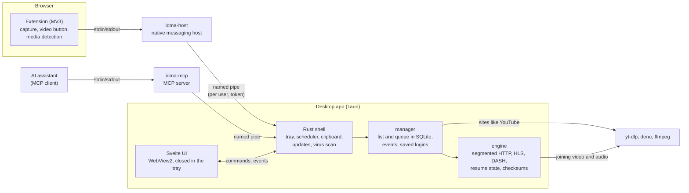

<h1 align="center">Shardload</h1>

<b>A free, open-source IDM alternative for Windows and Linux.</b> 
Splits every file into parts and downloads them at once, takes over the browser's downloads,
saves videos and torrents. No ads, no trial, no account.

<a href="https://github.com/monurpalan/idm-alternative/releases/latest/download/shardload-setup.exe"><b>⬇ Download for Windows</b></a>
&nbsp;·&nbsp;
<a href="https://github.com/monurpalan/idm-alternative/releases/latest">Linux (.deb, AppImage)</a>
&nbsp;·&nbsp;
<a href="README.tr.md">Türkçe</a>

## Install

1. **Run `shardload-setup.exe`.** It installs for your Windows user only, without administrator
   rights, and checks for new versions once a day.
   The installer is not code-signed yet, so Windows may say *"Windows protected your PC"*:
   click **More info → Run anyway**.
2. **Add the browser extension** from the
   [latest release](https://github.com/monurpalan/idm-alternative/releases/latest) (not in the
   stores yet):
   - Chrome, Edge, Brave, Vivaldi, Opera: unzip `shardload-extension-chromium.zip`, open
     `chrome://extensions`, turn on *Developer mode*, *Load unpacked* and pick the folder.
   - Firefox: unzip `shardload-extension-firefox.zip`, open `about:debugging#/runtime/this-firefox`,
     *Load Temporary Add-on…* and pick `manifest.json` (until the extension is signed, Firefox
     forgets it when it restarts).
3. **That's it.** Downloads you start in the browser now open in Shardload. You can also paste a
   link with Ctrl+V or drop one on the window.

**Linux (x64):** the `.deb` (`sudo apt install ./idm-alternative_*_amd64.deb`) or the AppImage
(`chmod +x`, then run it) from the same release.

## What it does

- **Faster downloads.** Up to 16 connections per file. When one connection slows down, a free
  one takes over the rest of its part, so the last percent does not drag. Resumes after a crash
  or restart and checks the file against the publisher's checksum when there is one.
- **Takes over the browser's downloads** in Chrome, Edge, Brave, Vivaldi, Opera and Firefox,
  with their cookies, so downloads behind a login work too. An expired link is renewed by
  starting the download again in the browser.
- **Video.** A Download button over videos in the page. YouTube, X, Instagram, TikTok, Twitch and
  many more through yt-dlp, which the app sets up and keeps up to date; HLS and DASH streams with
  a choice of quality, audio track and subtitles.
- **Torrents.** Magnet links and `.torrent` files in the same list, with a choice of files;
  nothing keeps seeding afterwards.
- **One file from several servers at once** (mirrors and Metalink), each checked to serve the
  same bytes.
- **Just the files you need out of a ZIP**, without downloading the whole archive.
- **Site grabber.** Lists every file a site links to (archives, documents, video, pictures) so
  you can pick which to download.
- **Everything you know from IDM:** categories, a queue with automatic retries, a scheduler,
  sleep or shut down when all downloads finish, batch downloads (`photo[001-100].jpg`),
  clipboard monitoring, saved logins per site, a virus scan of finished files, a small progress
  window per download, a tray icon and speed limits.
- **For AI assistants:** an [MCP](https://modelcontextprotocol.io) server, installed with the
  app, lets an assistant add, find, watch and manage downloads for you.
- **Command line:** `shard`, the same engine in a terminal (built from source for now, see
  [docs/DEVELOPMENT.md](docs/DEVELOPMENT.md)).
- English and Turkish.

| | |
|---|---|
|  |  |
|  |  |

## How it compares

**Speed.** Seconds, lower is better; medians of several runs on one machine and one line
([how it was measured](#speed-tests)):

| | Shardload | IDM 6.43 | aria2 | AB Download Manager | Gopeed |
|---|---:|---:|---:|---:|---:|
| Internet, 1000 MiB | **12.94** | 20.04 | 15.46 | 23.91 | 48.25 |
| One connection slows to 64 KiB/s | **2.40** | 8.61 | 10.28 | 31.58 | 10.10 |
| Connections drop every 4 MiB | **1.50** | 4.82 | 3.14 | 9.87 | 7.51 |

**Features**, as each project describes itself on its own site or README (checked 2026-10-18;
"?" where it does not say):

| | Shardload | IDM | Free Download Manager | Gopeed | AB Download Manager |
|---|---|---|---|---|---|
| Price | Free | 30-day trial, then paid | Free | Free | Free |
| Source code | Open (MIT) | Closed | Open¹ | Open (GPL-3.0) | Open (Apache-2.0) |
| Windows · Linux | ✓ · ✓ | ✓ · – | ✓ · ✓ | ✓ · ✓ | ✓ · ✓ |
| macOS · Android | – · – | – · – | ✓ · ✓ | ✓ · ✓ | ✓ · ✓ |
| Browser extension | ✓ | ✓ | ✓ | ✓ | ✓ |
| Torrents and magnet links | ✓ | – | ✓ | ✓ | ? |
| YouTube and other video sites | Built in | Video the page plays | Through add-ons | Through extensions | ? |
| Queue and scheduler | ✓ | ✓ | ? | ? | ✓ |

1. Its site calls it open source but names no license.

Shardload also picks files out of a ZIP without downloading the archive, downloads one file
from several mirrors at once, lists the files a whole site links to, and can be driven by an AI
assistant over MCP; see [every feature](#every-feature) below.

## In detail

For those who want to know exactly what it does, how it was measured and how it is built.

### Every feature

- **Fast, resilient downloads.** Up to 16 connections per file with time-based work stealing:
  a connection that crawls has its range taken over, so the last percent does not drag. One
  preallocated file (no joining parts at the end), resume after a crash or `kill -9`, checksum
  verification (the publisher's own checksum is found by itself: GitHub's digest of a release
  asset, or `SHA256SUMS`, `<file>.sha256` and the like next to the file), HTTP/2, browser TLS
  fingerprints, proxies, global and per-download speed limits.
- **Mirrors and Metalink.** Other addresses of the same file are used at the same time once
  each is shown to serve the same bytes; new connections go to the source that gives a
  connection the most, and a mirror that fails or crawls is dropped. A `.meta4` / `.metalink`
  link brings its mirrors, name and checksum by itself (`shard get URL -m MIRROR`, or "Add
  mirror links…" in the app).
- **Browser integration** for Chrome, Edge, Brave, Vivaldi, Opera and Firefox: downloads are taken over with the
  browser's cookies, referrer and user agent, over native messaging (no open localhost port).
  An expired link is refreshed by starting the download again in the browser.
- **Video.** A download button over videos in the page; HLS and DASH downloaded by the engine
  itself (parallel segments, AES-128) with quality, audio track and subtitle choice; sites such
  as YouTube and X through yt-dlp, which the app installs and keeps up to date. Tried on
  2026-10-18 with public pages: YouTube, X, TikTok, Instagram, Facebook, Twitch, Dailymotion,
  Bilibili, VK, Bluesky, SoundCloud, Bandcamp, Internet Archive, PeerTube, Streamable and Odysee
  worked without a login; Vimeo and Reddit asked for one.
- **Site grabber:** reads a page and, to a chosen depth, the pages below it on the same site,
  and lists the files they link to (archives, documents, video, pictures) to pick from;
  nothing is downloaded to find them. Also an MCP tool (`find_site_files`).
- **Files out of a ZIP archive** without downloading the rest: when the server supports range
  requests, the archive's list of files is read from its end, and only the chosen files are
  fetched and unpacked (stored or deflate, ZIP64 too, each checked against its CRC-32) into a
  folder named after the archive. "Pick files from the archive…" in the app, `shard zip list
  URL` / `shard zip get URL 'docs/**/*.pdf' -d out`, and the MCP tool `inspect_archive`. Without
  range support the whole archive is downloaded.
- **Torrents:** magnet links and `.torrent` files (librqbit) in the same list and queue, with
  a choice of files; nothing seeds after a download is done. Opening magnet links and
  `.torrent` files from Windows is a setting, off by default.
- **Like IDM:** categories, a queue with automatic retries, a scheduler, "when done" sleep or
  shut down, batch downloads (`photo[001-100].jpg`), clipboard monitoring, saved logins per
  site, a virus scan when a download finishes, a small progress window per download, and a
  tray icon. Interface in English and Turkish.
- **For AI assistants:** `idma-mcp`, an [MCP](https://modelcontextprotocol.io) server installed
  with the app, lets any MCP client add downloads (files, chosen files out of ZIP archives,
  torrents with a choice of files, metalinks, video pages at a chosen quality), find the files
  a site links to, list downloads with their progress, wait for them to finish, pause, resume,
  reorder and remove them, limit their speed and choose what happens when all are done. It
  reaches the app through the same per-user pipe as the browser; nothing listens on a network port. Register it in the client
  as a stdio server whose command is `%LOCALAPPDATA%\idm-alternative\idma-mcp.exe`.

### Speed tests

`shard` (Shardload's engine from the command line; `dm` in the result files, its
earlier name) against IDM 6.43, Gopeed 1.9.3, AB Download Manager
1.11.1, aria2 and curl, measured with [`idma-bench`](bench/README.md) on 2026-10-18. Every file was
verified byte for byte (local) or by size and SHA-256 (internet). Medians of 3 runs, clients in a
new shuffled order each round (internet: 5 runs). Free Download Manager is not in the table: it has
no command line or local API to start a download from.

**Seconds, lower is better** ([local](bench/results/2026-10-18_011811.md), internet
[1000 MiB](bench/results/2026-10-18_133925.md) and [100 MiB](bench/results/2026-10-18_134205.md)). `shard x8` uses IDM's and AB DM's default of 8
connections; the others use their defaults (shard, aria2 and Gopeed 16).

| Scenario | shard | shard x8 | IDM | aria2 | Gopeed | AB DM¹ | curl |
|---|---:|---:|---:|---:|---:|---:|---:|
| Internet, 1000 MiB² | **12.94** | 16.05 | 20.04 | 15.46 | 48.25 | 23.91 | 25.24 |
| Internet, 100 MiB² | 2.59 | **2.42** | 3.89 | 3.18 | 6.16 | 2.86 | 5.35 |
| Clean, 1 GiB, local³ | 3.54 | **2.80** | 5.99 | 6.88 | 16.12 | 8.38 | 3.87 |
| 4 MiB/s per connection, 256 MiB | **4.05** | 8.04 | 9.75 | 4.20 | 4.17 | 8.04 | 64.03 |
| One connection crawls at 64 KiB/s | **2.40** | 4.43 | 8.61 | 10.28 | 10.10 | 31.58 | 32.03 |
| Server allows 4 connections | 8.35 | **8.14** | 9.04 | 8.27 | 13.18 | 9.23 | 32.03 |
| Connections reset every 4 MiB | **1.50** | 3.09 | 4.82 | 3.14 | 7.51 | 9.87 | fails |
| No range support, 128 MiB | **8.03** | 8.03 | 8.88 | 8.12 | 8.12 | 8.12 | 8.03 |
| Says it has ranges, sends the whole file | **8.03** | 8.03 | 8.92 | 8.11 | **corrupt** | 8.12 | 8.02 |

1. AB DM's own time from its download record (added → complete). Started through its command-line
   tool, which takes about a second more; with it the times are ~1 s higher.
2. Linode Frankfurt, from Turkey, ~470 Mbit/s line, Sunday 13:30, 5 runs each. shard's slowest
   1000 MiB run (13.68 s) beat every other client's median. A run the night before at 03:00 was
   too noisy to use: the same client swung by 2 to 8 times between runs
   ([results](bench/results/2026-10-18_033423.md)).
   **IDM with 16 connections** (`MaxConnectionsNumber` in its registry key) was no faster on the
   internet: 19.91 s for 1000 MiB against 18.82 s with its default 8, shard 13.2–13.5 s in the same
   sessions ([16](bench/results/2026-10-18_132257.md), [8](bench/results/2026-10-18_132500.md));
   locally it gained only where each connection is capped
   ([results](bench/results/2026-10-18_132052.md)).
3. The clean local run mostly measures the disk (a DRAM-less SSD that slows down while it writes
   back): the same client swings by a factor of two between runs.

**Scenarios added to find where shard loses** (2026-10-18; results: [per-client limit](bench/results/2026-10-18_020038.md),
[403](bench/results/2026-10-18_021842.md), [latency](bench/results/2026-10-18_022025.md),
[tiny](bench/results/2026-10-18_022033.md), [shard after the fix](bench/results/2026-10-18_024457.md)):

| Scenario | shard | shard x8 | IDM | aria2 | Gopeed | AB DM⁴ | curl |
|---|---:|---:|---:|---:|---:|---:|---:|
| 16 MiB/s for all connections together (a per-IP limit), 128 MiB | 8.04 | 8.04 | 9.01 | 8.12 | 8.17 | 9.02 | **8.02** |
| Server forbids (403) every connection beyond 4, 256 MiB | 8.35⁵ | **8.14**⁵ | 9.18 | 8.27 | hangs | 10.24 | 32.03 |
| 300 ms before every response, 4 MiB/s per connection, 64 MiB | **1.67** | 2.67 | 4.93 | 1.71 | 2.90 | 3.60 | 16.33 |
| A 256 KiB file | **0.02** | 0.02 | 0.96 | 0.03 | 0.13 | 1.06 | 0.02 |

4. Measured time here, including the ~1 s its command-line tool takes to start.
5. **shard failed this scenario** before 2026-10-18: it took the 403 for an expired link and stopped
   the whole download. Now a refusal while other connections still download lowers the
   connection count, like a 503; with no connection left working it is still an expired link.

What this does and does not say:

- **Where shard stands out is a bad connection.** When one connection crawls, shard finishes in 2.4 s
  because a finished connection takes over the slow one's range; Gopeed and aria2 wait for it
  (~10 s), AB DM much longer (31.6 s). The same holds, less sharply, when connections keep dropping.
- **Gopeed 1.9.3 wrote a corrupt file** when a server advertises ranges but answers every request
  with the whole file (all three runs, even with one connection); everyone else noticed and fell
  back to one connection. It is Gopeed's known issue
  [#1458](https://github.com/GopeedLab/gopeed/issues/1458): 2.0.0-beta.3 gets it right (checked
  here, 6 of 6), but 1.9.3 is still its latest stable release.
- **Gopeed's times swing between sessions, and 2.0 is not faster.** A second session with both
  versions and shard side by side ([local](bench/results/2026-10-18_014929.md),
  [internet](bench/results/2026-10-18_015011.md)):

  | Scenario | shard | Gopeed 1.9.3 | Gopeed 2.0.0-beta.3 |
  |---|---:|---:|---:|
  | Internet, 100 MiB | **2.55** | 5.09 | 5.64 |
  | Clean, 1 GiB, local | **3.37** | 33.81 | 16.39 |
  | One connection crawls | **2.48** | 13.14 | 23.26 |
  | Connections reset every 4 MiB | **1.50** | 9.06 | 12.43 |
  | Server allows 4 connections | **8.35** | 14.17 | 17.17 |
  | Says it has ranges, sends the whole file | **8.03** | corrupt | 8.13 |

  1.9.3 took 12.78 s on the internet run in the first session and 5.09 s here, so read Gopeed's
  plain-download numbers loosely; its slowness with a bad connection repeats in both.
- **On a plain download the gap is smaller.** On 100 MiB shard, aria2 and AB DM are within about a
  second of each other; on 1000 MiB shard is 16 % ahead of aria2 and 35 % ahead of IDM. Part of
  IDM's gap is not network: it downloads parts into its own folder and joins them at the end
  (~1–2.7 s per GiB here), and its start and exit are in the measurement.
- **Looking for losses found one.** A server that forbids extra connections with 403 made shard stop
  (fixed, see above) and makes Gopeed hang; aria2, IDM and AB DM drop to 4 connections. Where
  connections do not help (a per-client limit) everyone ties; the tiny file shows IDM's and AB
  DM's start-up cost, not their engines.
- **Not measured:** a destination on a hard disk or USB stick (IDM's download-then-join should do
  better there; this machine has no HDD), many small files in one go, and weak hardware.
- **One machine, one line, one server.** Everyone ran with default settings. Browser integration,
  site compatibility and video are not measured here.

### Size and memory

Measured on the development machine (release build, Windows 11):

| | |
|---|---|
| Installer | 9.6 MiB |
| Installed | 39.5 MB (app 35.9 MB, of which ~7 MB is the torrent client; MCP server 2.7 MB; browser host 0.8 MB) |
| Idle memory, app process | 32 MB working set (8 MB private) |
| Idle memory, WebView2 (6 processes) | 367 MB working set (160 MB private) |
| Idle in the tray (window closed) | 5 MB private, no WebView2 processes |
| 500 downloads in the list, 20 running (~10 MB/s) | UI 9% of a core, engine 18–22%; scrolling at 60 fps |

Most of the memory is the WebView2 runtime that every Tauri app shares with Edge; IDM's
native window needs far less. In the tray the app closes its window and the WebView with it,
so that price is only paid while the window is open.

### How it works

The engine knows one download at a time and nothing about lists; the manager owns the list,
the queue and the events; the app is a thin shell that the browser host and the MCP server
reach through a named pipe only this Windows user can open. The browser host passes on only
what the extension may send (downloads for the user to confirm); listing, adding without
asking and removing are for the user's own tools. More in [docs/ARCHITECTURE.md](docs/ARCHITECTURE.md),
the decisions in [docs/decisions](docs/decisions), and how to build it in
[docs/DEVELOPMENT.md](docs/DEVELOPMENT.md).

### On Linux

Built, tested and packaged on Ubuntu 24.04 in CI, but not yet tried much on a desktop: please
report what does not work. The app talks to the browser and the MCP server over a socket only
your user can open, registers the browser host in each browser's folder (not Snap or Flatpak
browsers), sleeps and shuts down through `systemctl`, and scans with ClamAV when virus scanning
is on. Clipboard monitoring is Windows-only for now.

## Questions

**Is it related to IDM?** No. Shardload is an independent project and is not affiliated with
Internet Download Manager or Tonec Inc.; the name only says what it is an alternative to.

**Is it safe?** The code is open, every release is built from it, and the release lists the
SHA-256 of each file in `SHA256SUMS`. The installer is not code-signed yet, which is why
Windows warns before running it.

**Where are my downloads and settings?** Files go to your Downloads folder unless you choose
another one. The list and settings live in `%APPDATA%\io.github.monurpalan.idma`.

**How do I uninstall it?** Windows Settings → Apps → *idm-alternative* → Uninstall. Uninstalling
also removes the browser registration; the download list stays in case you come back.

**Something does not work.** Please [open an issue](https://github.com/monurpalan/idm-alternative/issues)
with what you did and what happened; *Settings → App → Open the log folder* has the app's log.

## Building and contributing

See [docs/DEVELOPMENT.md](docs/DEVELOPMENT.md).

## License

[MIT](LICENSE)
