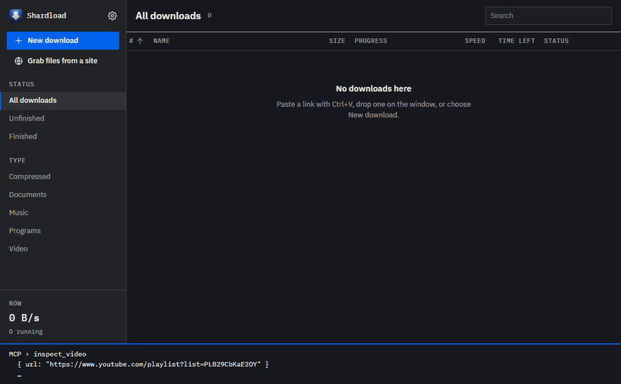

<h1 align="center">Shardload</h1>

<b>Windows ve Linux için ücretsiz, açık kaynaklı bir IDM alternatifi.</b> 
Her dosyayı parçalara bölüp aynı anda indirir, tarayıcının indirmelerini devralır, video ve
torrent indirir. Reklam yok, deneme süresi yok, hesap yok.

<a href="https://github.com/monurpalan/idm-alternative/releases/latest/download/shardload-setup.exe"><b>⬇ Windows için indir</b></a>
&nbsp;·&nbsp;
<a href="https://github.com/monurpalan/idm-alternative/releases/latest">Linux (.deb, AppImage)</a>
&nbsp;·&nbsp;
<a href="README.md">English</a>

## Kurulum

1. **`shardload-setup.exe` dosyasını çalıştırın.** Yalnızca sizin Windows kullanıcınıza kurulur,
   yönetici izni gerekmez; yeni sürümü günde bir kez kendisi denetler.
   Kurulum dosyası henüz kod imzalı olmadığı için Windows *"Bilgisayarınız Windows tarafından
   korundu"* diyebilir: **Ek bilgi → Yine de çalıştır**'a tıklayın.
2. **Tarayıcı eklentisini ekleyin.** Eklenti henüz mağazalarda değil; dosyaları
   [son sürüm](https://github.com/monurpalan/idm-alternative/releases/latest) sayfasında:
   - Chrome, Edge, Brave, Vivaldi, Opera: `shardload-extension-chromium.zip` dosyasını açın,
     `chrome://extensions` sayfasında *Geliştirici modu*nu açın, *Paketlenmemiş öğe yükle* ile
     klasörü seçin.
   - Firefox: `shardload-extension-firefox.zip` dosyasını açın,
     `about:debugging#/runtime/this-firefox` sayfasında *Geçici Eklenti Yükle…* ile
     `manifest.json` dosyasını seçin. Eklenti imzalanana kadar Firefox onu yeniden başlayınca
     unutur.
3. **Bu kadar.** Tarayıcıda başlattığınız indirmeler artık Shardload'da açılır. Bir bağlantıyı
   Ctrl+V ile yapıştırabilir ya da pencereye sürükleyip bırakabilirsiniz.

**Linux (x64):** aynı sürümdeki `.deb` (`sudo apt install ./shardload_*_amd64.deb`) ya da
AppImage (`chmod +x` ve çalıştırın).

## Neler yapar

- **Daha hızlı indirme.** Dosya başına 16 bağlantıya kadar. Bir bağlantı yavaşlarsa boşta kalan
  bir bağlantı onun kalan kısmını devralır; son yüzde sürünmez. Çökme ya da yeniden başlatmadan
  sonra kaldığı yerden sürer, yayıncının sağlama toplamı varsa dosyayı onunla denetler.
- **Tarayıcının indirmelerini devralır.** Chrome, Edge, Brave, Vivaldi, Opera ve Firefox'ta,
  çerezleriyle birlikte; giriş gerektiren indirmeler de çalışır. Süresi dolan bir bağlantı,
  indirme tarayıcıda yeniden başlatılarak yenilenir.
- **Video.** Sayfadaki videoların üstünde bir İndir düğmesi. YouTube, X, Instagram, TikTok,
  Twitch ve daha birçok site yt-dlp ile; uygulama onu kendisi kurar ve günceller. HLS ve DASH
  yayınlarında kalite, ses ve altyazı seçimi.
- **Oynatma listeleri, kanallar, klipler ve canlı yayınlar.** Bir YouTube listesi ya da kanalı
  videolarını seçmeniz için listeler; bir videonun yalnızca bir bölümü (ör. 1:05–2:30) istenirse
  yalnız o bölüm iner; canlı yayın bitene kadar kaydedilir, isterseniz belli bir saatte başlar.
- **Hatırlar.** Daha önce indirdiğiniz bir şeyi eklerken söyler; her sitenin neye izin
  verdiğini (kaç bağlantı, hangi tarayıcı) öğrenir, sonraki indirme doğru başlar.
- **Bu dosya nereden geldi?** Bir dosyayı pencereye bırakın: indirildiği sayfayı görün, yeniden
  denetleyin ya da yeni sürümü var mı bakın.
- **Torrent.** Magnet bağlantıları ve `.torrent` dosyaları aynı listede, dosya seçerek;
  indirme bitince arkada paylaşmaya devam etmez.
- **Bir dosyayı aynı anda birkaç sunucudan indirir** (aynalar ve Metalink); her sunucunun aynı
  baytları verdiği denetlenir.
- **ZIP arşivinden yalnızca istediğiniz dosyalar**, arşivin tamamını indirmeden.
- **Site tarayıcı.** Bir sitenin bağlantı verdiği bütün dosyaları (arşiv, belge, video, resim)
  listeler; hangilerinin indirileceğini siz seçersiniz.
- **IDM'den bildiğiniz her şey:** kategoriler, otomatik yeniden denemeli kuyruk, zamanlayıcı,
  hepsi bitince uyku ya da kapatma, toplu indirme (`foto[001-100].jpg`), pano izleme, site
  başına kayıtlı girişler, biten dosyalarda virüs taraması, indirme başına küçük ilerleme
  penceresi, sistem tepsisi simgesi ve hız sınırları.
- **Yapay zekâ asistanları için:** uygulamayla birlikte kurulan bir
  [MCP](https://modelcontextprotocol.io) sunucusu; bir asistan sizin için indirme ekleyip
  bulabilir, izleyip yönetebilir.

  
- **Komut satırı:** `shard`, aynı motor terminalde (şimdilik kaynaktan derleniyor, bkz.
  [docs/DEVELOPMENT.md](docs/DEVELOPMENT.md)).
- Türkçe ve İngilizce arayüz.

## Karşılaştırma

**Hız.** Saniye, düşük olan daha iyi; tek makine ve tek hatta birkaç ölçümün ortancası
([nasıl ölçüldü](README.md#speed-tests)):

| | Shardload | IDM 6.43 | aria2 | AB Download Manager | Gopeed |
|---|---:|---:|---:|---:|---:|
| İnternet, 1000 MiB | **12.94** | 20.04 | 15.46 | 23.91 | 48.25 |
| Bir bağlantı 64 KiB/sn'ye düşüyor | **2.40** | 8.61 | 10.28 | 31.58 | 10.10 |
| Bağlantılar her 4 MiB'da kopuyor | **1.50** | 4.82 | 3.14 | 9.87 | 7.51 |

**Özellikler**, her projenin kendi sitesinde ya da README'sinde yazdığı kadarıyla (18 Ekim 2026'da
bakıldı; yazmıyorsa "?"):

| | Shardload | IDM | Free Download Manager | Gopeed | AB Download Manager |
|---|---|---|---|---|---|
| Fiyat | Ücretsiz | 30 gün deneme, sonra ücretli | Ücretsiz | Ücretsiz | Ücretsiz |
| Kaynak kodu | Açık (MIT) | Kapalı | Açık¹ | Açık (GPL-3.0) | Açık (Apache-2.0) |
| Windows · Linux | ✓ · ✓ | ✓ · – | ✓ · ✓ | ✓ · ✓ | ✓ · ✓ |
| macOS · Android | – · – | – · – | ✓ · ✓ | ✓ · ✓ | ✓ · ✓ |
| Tarayıcı eklentisi | ✓ | ✓ | ✓ | ✓ | ✓ |
| Torrent ve magnet | ✓ | – | ✓ | ✓ | ? |
| YouTube ve diğer video siteleri | Yerleşik | Sayfanın oynattığı video | Eklentilerle | Eklentilerle | ? |
| Kuyruk ve zamanlayıcı | ✓ | ✓ | ? | ? | ✓ |

1. Sitesi açık kaynak diyor ama bir lisans adı vermiyor.

Ayrıntılı özellik listesi, bütün hız testleri, bellek ve boyut ölçümleri ve nasıl çalıştığı
[İngilizce README'de](README.md#in-detail).

## Sorular

**IDM ile bir ilgisi var mı?** Hayır. Shardload bağımsız bir projedir; Internet Download Manager
ya da Tonec Inc. ile bağlantısı yoktur. Ad yalnızca neyin alternatifi olduğunu söyler.

**Güvenli mi?** Kod açık, her sürüm bu koddan derlenir ve sürümde her dosyanın SHA-256 değeri
`SHA256SUMS` dosyasında yer alır. Kurulum dosyası henüz kod imzalı değil; Windows'un uyarması
bundandır.

**İndirmelerim ve ayarlarım nerede?** Dosyalar, başka bir klasör seçmediyseniz İndirilenler
klasörüne iner. Liste ve ayarlar `%APPDATA%\io.github.monurpalan.shardload` klasöründe durur.

**Nasıl kaldırılır?** Windows Ayarlar → Uygulamalar → *Shardload* → Kaldır. Kaldırma,
tarayıcı kaydını da siler; geri dönerseniz diye indirme listesi kalır.

**Bir şey çalışmıyor.** Lütfen ne yaptığınızı ve ne olduğunu yazarak bir
[issue açın](https://github.com/monurpalan/idm-alternative/issues); *Ayarlar → Uygulama → Kayıt
klasörünü aç* uygulamanın kayıtlarını gösterir.

## Lisans

[MIT](LICENSE)
