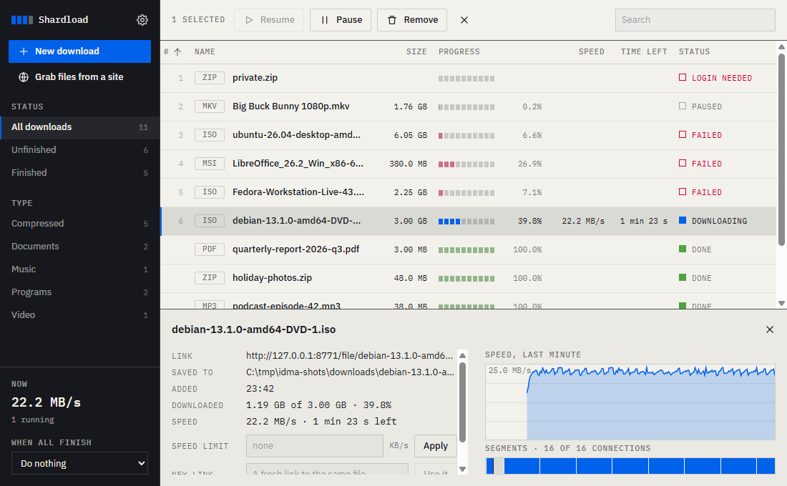
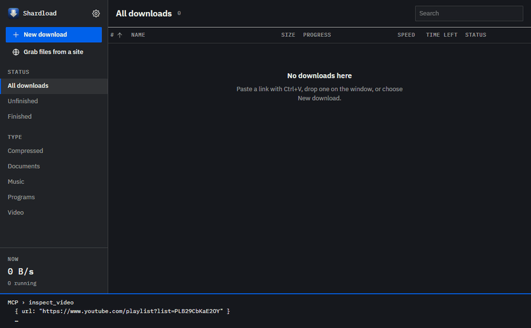

<h1 align="center">Shardload</h1>

<b>Windows ve Linux için ücretsiz, açık kaynaklı bir IDM alternatifi.</b> 
Her dosyayı parçalara bölüp aynı anda indirir, tarayıcının indirmelerini devralır, video ve
torrent indirir. Reklam yok, deneme süresi yok, hesap yok.

<a href="https://github.com/monurpalan/Shardload-idm-alternative/releases/latest/download/shardload-setup.exe"><b>⬇ Windows için indir</b></a>
&nbsp;·&nbsp;
<a href="https://github.com/monurpalan/Shardload-idm-alternative/releases/latest">Linux (.deb, .rpm, Flatpak, AppImage)</a>
&nbsp;·&nbsp;
<a href="README.md">English</a>

## Kurulum

1. **`shardload-setup.exe` dosyasını çalıştırın.** Yalnızca sizin Windows kullanıcınıza kurulur,
   yönetici izni gerekmez; yeni sürümü günde bir kez kendisi denetler (ayarlardan kapatılabilir).
   Kurulum dosyası henüz kod imzalı olmadığı için Windows *"Bilgisayarınız Windows tarafından
   korundu"* diyebilir: **Ek bilgi → Yine de çalıştır**'a tıklayın.
2. **Tarayıcı eklentisini ekleyin:**
   - Firefox: [Firefox Eklentileri](https://addons.mozilla.org/firefox/addon/shardload/) sayfasından.
   - Chrome, Edge, Brave, Vivaldi, Opera (henüz mağazalarında değil):
     [son sürüm](https://github.com/monurpalan/Shardload-idm-alternative/releases/latest) sayfasındaki
     `shardload-extension-chromium.zip` dosyasını açın, `chrome://extensions` sayfasında
     *Geliştirici modu*nu açın, *Paketlenmemiş öğe yükle* ile klasörü seçin.
3. **Bu kadar.** Tarayıcıda başlattığınız indirmeler artık Shardload'da açılır. Bir bağlantıyı
   Ctrl+V ile yapıştırabilir ya da pencereye sürükleyip bırakabilirsiniz.

**Linux (x64):** aynı sürümdeki `.deb` (`sudo apt install ./Shardload_*_amd64.deb`), `.rpm`
(`sudo dnf install ./Shardload-*.x86_64.rpm`), Flatpak
(`flatpak install --user ./Shardload_*_x86_64.flatpak`) ya da AppImage (`chmod +x` ve çalıştırın).

## Neler yapar

**İndirme**

- **Daha hızlı.** Dosya başına 16 bağlantı (Ayarlar'dan 64'e kadar). Bir bağlantı yavaşlarsa
  boşta kalan bir bağlantı onun kalan kısmını devralır; son yüzde sürünmez. Çökme ya da yeniden
  başlatmadan sonra kaldığı yerden sürer.
- **Tarayıcının indirmelerini devralır.** Chrome, Edge, Brave, Vivaldi, Opera ve Firefox'ta,
  çerezleriyle birlikte; giriş gerektiren indirmeler de çalışır.
- **Video.** Sayfadaki videoların üstünde bir İndir düğmesi. YouTube, X, Instagram, TikTok,
  Twitch ve daha birçok site yt-dlp ile; uygulama onu kendisi kurar ve günceller. HLS ve DASH'te
  kalite, ses ve altyazı seçimi. Bütün oynatma listeleri ve kanallar, bir videonun yalnızca bir
  bölümü (ör. 1:05–2:30), bitene kadar kaydedilen canlı yayınlar.
- **Torrent, FTP, FTPS ve SFTP** aynı listede ve kuyrukta.
- **Daha az indirir.** ZIP arşivinden yalnızca istediğiniz dosyalar; bir dosya aynı anda birkaç
  sunucudan; sunucu bir `.zsync` yayınlıyorsa elinizdeki dosyanın yeni sürümü sizdeki kopyadan
  kurulur.
- **Site tarayıcı.** Bir sitenin bağlantı verdiği bütün dosyaları seçmeniz için listeler.

**Denetleme**

- **İndirdiğini denetler:** kendi bulduğu yayıncı sağlama toplamıyla, o yoksa dosyanın kendi
  yapısıyla (ZIP, gzip, xz, PNG, PDF, MP4, MKV). Yalnızca bozuk kısım yeniden iner.
- **Zaten var mı?** Daha önce indirdiğiniz bir şeyi ya da elinizdekiyle aynı sağlama toplamına
  sahip bir dosyayı eklediğinizde söyler, elinizdekini önerir.
- **Önce iskelet:** ZIP'in dosyaları, videonun süresi ve çözünürlüğü, PDF'in sayfa sayısı ilk
  saniyelerde görünür; yanlış dosya erkenden durdurulabilir.
- **Kurtarır:** tarayıcının yarıda bıraktığı indirmeleri, indirilmiş kısmı koruyarak sürdürür;
  sunucusundan kalkmış bir dosya için Wayback Machine'i önerir.
- **Bu dosya nereden geldi?** Bir dosyayı pencereye bırakın: sayfasını görün, yeniden
  denetleyin ya da yeni sürümü var mı bakın.

**Kendi kendine**

- **Teslim saati** ("18:00'e kadar insin"), **ağ ve güç kuralları** (ölçülü bağlantı, pil,
  aylık veri bütçesi) ve **indirme bitince kurallar** (arşivi aç, taşı, program çalıştır,
  webhook'a bildir).
- **"Neden yavaş?"** Süren bir indirme, kesin bilindiğinde onu neyin tuttuğunu tek satırda
  söyler.
- **IDM'den bildiğiniz her şey:** kategoriler, yeniden denemeli kuyruk, zamanlayıcı, bitince
  uyku ya da kapatma, toplu indirme (`foto[001-100].jpg`), pano izleme, kayıtlı girişler, virüs
  taraması, indirme başına ilerleme penceresi, sistem tepsisi simgesi ve hız sınırları.
- **Yapay zekâ asistanları için** bir [MCP](https://modelcontextprotocol.io) sunucusu, komut
  satırı için `shard` (şimdilik kaynaktan derleniyor, bkz.
  [docs/DEVELOPMENT.md](docs/DEVELOPMENT.md)).
- Türkçe ve İngilizce arayüz.

## Karşılaştırma

**Hız.** Saniye, düşük olan daha iyi; tek makine ve tek hatta birkaç ölçümün ortancası
([nasıl ölçüldü](README.md#speed-tests)):

| | Shardload x16 | IDM 6.43 | aria2 | AB Download Manager | Gopeed |
|---|---:|---:|---:|---:|---:|
| İnternet, 1000 MiB | **12.94** | 20.04 | 15.46 | 23.91 | 48.25 |
| Bir bağlantı 64 KiB/sn'ye düşüyor | **2.39** | 8.72 | 10.25 | 32.53 | 10.64 |
| Bağlantılar her 4 MiB'da kopuyor | **1.50** | 4.86 | 1.57 | 10.82 | 7.50 |

**Özellikler**, her projenin kendi sitesinde ya da README'sinde yazdığı kadarıyla (18 Ekim 2026'da
bakıldı; yazmıyorsa "?"):

| | Shardload | IDM | Free Download Manager | Gopeed | AB Download Manager |
|---|---|---|---|---|---|
| Fiyat | Ücretsiz | 30 gün deneme, sonra ücretli | Ücretsiz | Ücretsiz | Ücretsiz |
| Kaynak kodu | Açık (MIT) | Kapalı | Açık¹ | Açık (GPL-3.0) | Açık (Apache-2.0) |
| Windows · Linux | ✓ · ✓ | ✓ · – | ✓ · ✓ | ✓ · ✓ | ✓ · ✓ |
| macOS · Android | – · – | – · – | ✓ · ✓ | ✓ · ✓ | ✓ · ✓ |
| Tarayıcı eklentisi | ✓ | ✓ | ✓ | ✓ | ✓ |
| Torrent ve magnet | ✓ | – | ✓ | ✓ | ? |
| YouTube ve diğer video siteleri | Yerleşik | Sayfanın oynattığı video | Eklentilerle | Eklentilerle | ? |
| Kuyruk ve zamanlayıcı | ✓ | ✓ | ? | ? | ✓ |

1. Sitesi açık kaynak diyor ama bir lisans adı vermiyor.

**Bellek** (geliştirme bilgisayarı, Windows 11, 2026-11-01; uygulama ve WebView2 süreçlerinin
toplamı; *ayrılmış* = commit, *RAM'de* = özel çalışma kümesi):

| | Shardload | IDM 6.43 | FDM 6.35 | AB DM 1.11 |
|---|---|---|---|---|
| Pencere açık, boşta | 200 MB ayrılmış (uygulama 13 MB, WebView2 ~190 MB); RAM'de pencere odakta değilken 17 MB, odaktayken ~130 MB | ~11 MB | 210 MB | 443 MB |
| 500 indirmelik liste | aynı (yalnız görünen satırlar çizilir) | – | – | – |
| 1 GiB indirirken | 240–275 MB ayrılmış, ~110 MB RAM'de | 15–20 MB | – | 530–670 MB |
| Tepside (pencere kapalı) | 18 MB ayrılmış, 15 MB RAM'de, tek süreç | ~14 MB | 210 MB | 593 MB |

Shardload'un belleğinin çoğu, Tauri uygulamalarının Edge ile paylaştığı WebView2'dir; pencere
kapanınca onunla birlikte kapanır. FDM (Qt) ve AB DM (JVM) tepside de belleklerini tutar. Yöntem ve ham sayılar:
[bench/results/2026-11-01_memory.md](bench/results/2026-11-01_memory.md).

Ayrıntılı özellik listesi, bütün hız testleri, bellek ve boyut ölçümleri ve nasıl çalıştığı
[İngilizce README'de](README.md#in-detail).

## Sorular

**IDM ile bir ilgisi var mı?** Hayır. Shardload bağımsız bir projedir; Internet Download Manager
ya da Tonec Inc. ile bağlantısı yoktur. Ad yalnızca neyin alternatifi olduğunu söyler.

**Güvenli mi?** Kod açık, her sürüm bu koddan derlenir ve sürümde her dosyanın SHA-256 değeri
`SHA256SUMS` dosyasında yer alır. Kurulum dosyası henüz kod imzalı değil; Windows'un uyarması
bundandır.

**İndirmelerim ve ayarlarım nerede?** Dosyalar, başka bir klasör seçmediyseniz İndirilenler
klasörüne iner. Liste ve ayarlar `%APPDATA%\io.github.monurpalan.shardload` klasöründe durur
(Linux'ta `~/.local/share/io.github.monurpalan.shardload`).

**Nasıl kaldırılır?** Windows Ayarlar → Uygulamalar → *Shardload* → Kaldır. Kaldırma,
tarayıcı kaydını da siler; geri dönerseniz diye indirme listesi kalır.

**Bir şey çalışmıyor.** Lütfen ne yaptığınızı ve ne olduğunu yazarak bir
[issue açın](https://github.com/monurpalan/Shardload-idm-alternative/issues); *Ayarlar → Uygulama → Kayıt
klasörünü aç* uygulamanın kayıtlarını gösterir.

## Lisans

[MIT](LICENSE)
